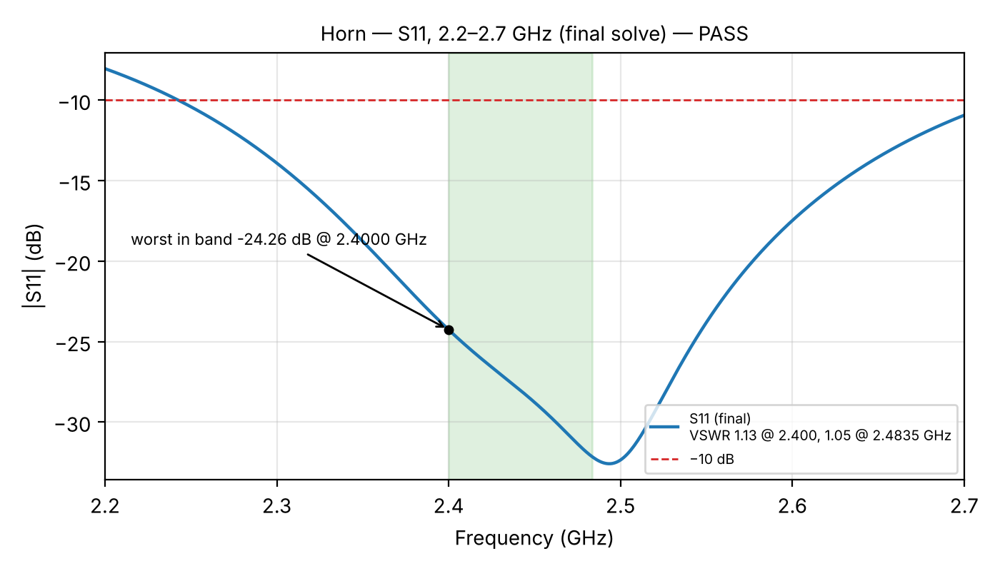
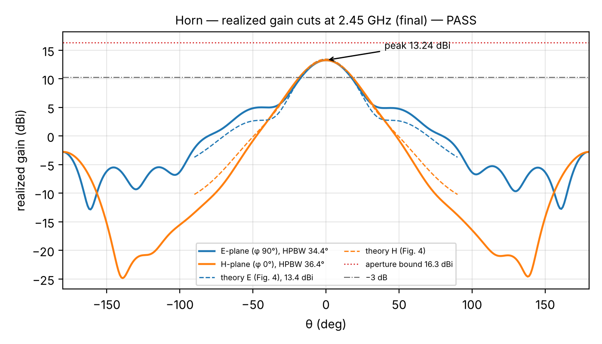

# antenna — the horn

A pyramidal horn for 2.45 GHz, fed by a coax probe in a short section of WR-340 waveguide.
I'm cutting three from 24 gauge copper: TX, RX and a spare.

## Design

| | |
|---|---|
| frequency | 2.45 GHz (band 2400–2483.5 MHz) |
| waveguide | 86.4 × 43.2 mm (WR-340) |
| mouth | 263.8 × 193.1 mm |
| flare length | 91.5 mm |
| probe | **27 mm long, 17.7 mm from the inside of the back wall**, centered on the top wall |
| expected gain | 13.4 dBi, beam about 34° × 36° |

The probe numbers come from the HFSS sweep below, not the usual quarter-wavelength rule.

## HFSS results

| what | result | needed |
|---|---|---|
| worst match (S11) in band | −24.3 dB | below −10 dB |
| gain at 2.400 / 2.442 / 2.483 GHz | 13.24 / 13.24 / 13.27 dBi | 12.5–14 dBi |
| beam width E / H plane | 34.4° / 36.4° | theory 33.4° / 35.2° |
| leakage into the RX horn at 290 mm | −49.4 dB | below −35 dB |
| worst match with the probe off by ±1 mm | −14.5 dB | below −10 dB |
| three mesh sizes (8.8k / 11.9k / 28.8k cells) | gain 13.28 / 13.24 / 13.14 dBi | spread under 0.2 dB |
| copper instead of perfect metal | 13.25 dBi, −24.1 dB | within 0.2 dB |

What it means:

- **The horn works as designed.** Gain and beam width land right on the theory numbers, and at
  −24 dB less than 0.4 % of the power reflects back to the transmitter.
- **The first probe position didn't work.** With the textbook spot (28 mm long, 43.7 mm from the
  back wall) the best match was −5.2 dB, so about 30 % reflected. The back wall was a quarter
  wavelength away, which made the probe see about 95 − 76j Ω instead of 50 Ω. Moving it to
  17.7 mm brings that to 52 + 3j Ω ([`results/scan_diagnosis.png`](results/scan_diagnosis.png)).
- **I picked the spot that survives build error.** I swept probe length 25–29 mm and position
  12.7–22.7 mm on a 1 mm grid (57 runs) and took the point whose worst neighbor is still good
  ([`results/scan_heatmap.png`](results/scan_heatmap.png)). Probe length matters most: 1 mm too
  long costs about 9 dB of match, so cut it long and trim it.
- **The two horns barely see each other.** −49.4 dB at 290 mm leaves lots of margin.
- **It's not a mesh artifact.** A 3× finer mesh and real copper give the same answer.

## Files

| file | what |
|---|---|
| [`horn-build-guide.pdf`](horn-build-guide.pdf) | every piece drawn flat to scale, the cutting layout, fold angles and build steps |
| [`waterjet/`](waterjet/) | DXF cut files for an OMAX waterjet, one sheet per horn |
| [`results/`](results/) | the HFSS data (CSV) and plots |

## Things the simulation doesn't cover

- Seams: the model's walls are continuous. Solder every seam all the way along.
- The SMA connector itself and the cable. If the match is off on the bench, trim the probe in
  0.5 mm steps.
