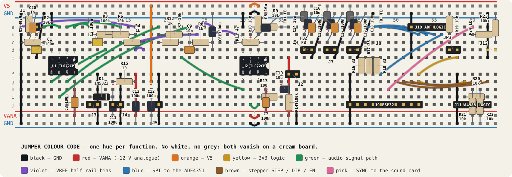

# breadboard — the baseband board

Everything between the mixer's IF port and the USB audio interface, plus the
power entry and the ESP32 / ADF4351 harness, on one 830-point breadboard:
video amplifier, half-rail reference, 12 V input, sync divider.

| folder | what |
|---|---|
| [`schematics/`](schematics/) | three KiCad sheets and their PNGs: `radar_flow` (how everything connects, in signal order), `radar_breadboard` (the board at component level), `radar_multisim` (each test block drawn alone with its sources and expected readings) |
| [`layout/`](layout/) | the board: [`WIRING.md`](layout/WIRING.md) gives every part's lead → hole, every jumper and every net, verified against the schematic netlist; [`breadboard.html`](layout/breadboard.html) is the interactive version (hover or click any part, wire, net or hole) |
| [`assembly/`](assembly/) | [`ASSEMBLY.md`](assembly/ASSEMBLY.md): the build in 17 pictured steps, each ending with a check |
| [`parts/`](parts/) | [`PARTS.md`](parts/PARTS.md), the stockroom pick list (every value, how many, what may be substituted), and [`MODULES.md`](parts/MODULES.md), the pinouts of the TL072, ESP32, A4988, ADF4351 and the interface |
| [`multisim/`](multisim/) | the Multisim projects for each block and the whole board, with the simulated results |

## Multisim status

All eight blocks have been simulated in Multisim with library parts and every check passes.
The projects, plots and numbers are in [`multisim/`](multisim/README.md).

One change came out of it: **C6 is now 3.3 mF (was 47 µF)**. With the whole board on one sheet,
the half-rail reference moved with the signal and cost up to 6.4 dB of gain. The layout, wiring
list, build steps, parts list and schematics all have the new value. The schematic PNGs still
show 47u until I re-export them from KiCad.
